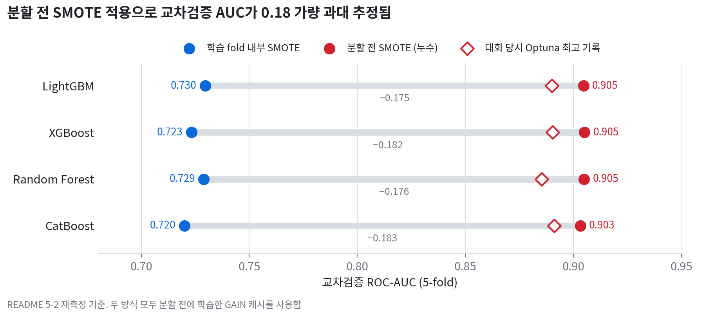
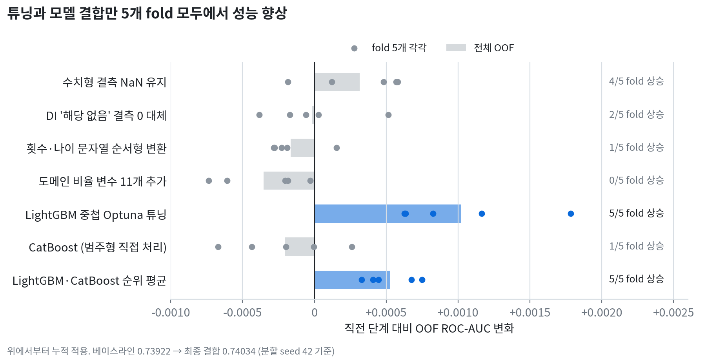
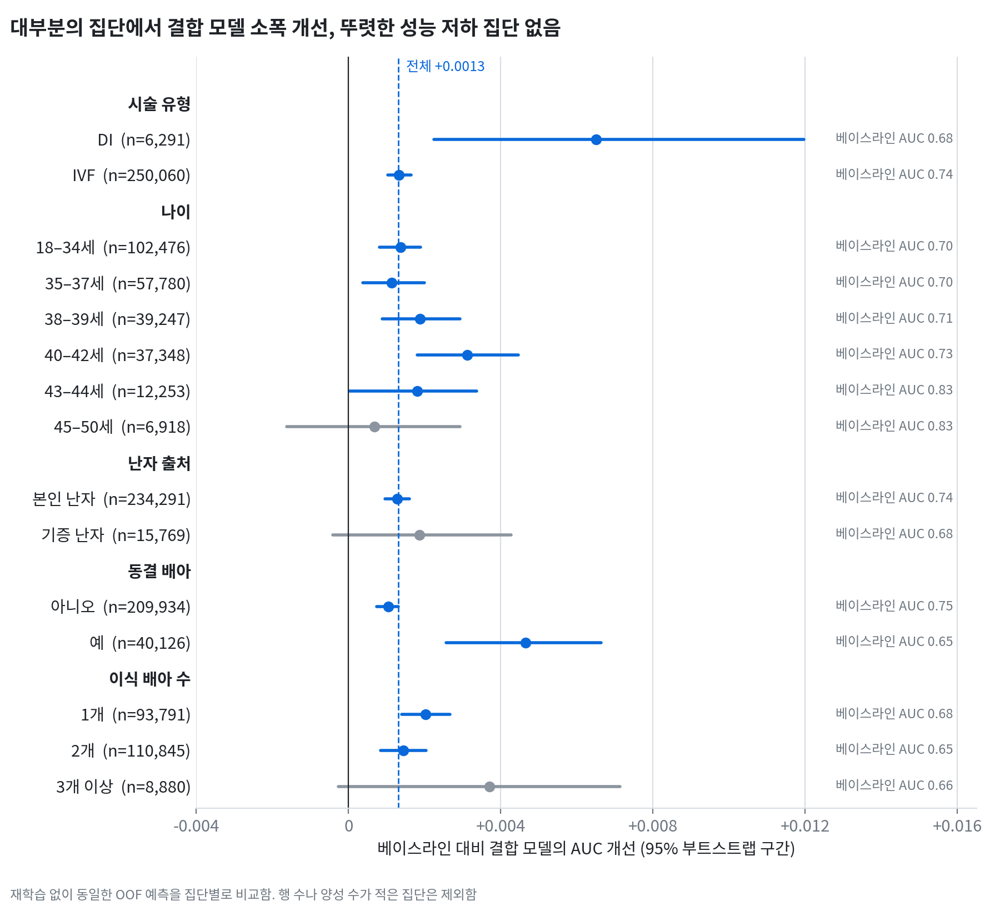

# 난임환자 대상 임신 성공 여부 예측

[English](README.md) | **한국어**

[](https://github.com/soonjae-dev/IVF-Pregnancy-Prediction/actions/workflows/tests.yml)

> **요약**
>
> - 대회 성적은 하위권(Private 544/794위, AUC 0.714)
> - 사후 분석을 통해 SMOTE 적용 과정에서 누수가 발생해 교차검증 AUC가 0.18 가량 부풀어 있음을 확인함([5-2](#5-2-smote-누수에-따른-튜닝-점수-과대-추정))
> - 이후 fold 안에서만 학습하는 재현 가능한 베이스라인(교차검증 AUC 0.739)을 구축함([5-4](#5-4-누수-없는-베이스라인))

## 1. 프로젝트 개요

<p align="center">
  
</p>

**대회 주제**

LG Aimers 6기 온라인 해커톤 과제로, 난임 환자의 시술 데이터로 임신 성공 여부를 예측하고
임신 성공을 좌우하는 특성을 찾는 AI 모델을 개발한다.

**대회 결과** (평가 지표: ROC-AUC)

| | Public | Private |
|---|---:|---:|
| 내 점수 | 0.71516 | 0.71446 |
| 순위 | 545 / 794 | 544 / 794 |
| 1위 점수 | 0.74350 | 0.74377 |

## 2. 데이터셋 개요

| 항목 | 값 |
|---|---|
| 학습 데이터 | 256,351행 × 69열 (ID, 타깃 포함) |
| 테스트 데이터 | 90,067행 × 68열 |
| 입력 특성 | 67개 (범주형 20개, 수치형 47개) |
| 타깃 | `임신 성공 여부`, 양성 비율 25.8% |
| 결측 | 입력 특성 셀의 10.3%, 결측이 있는 열 31개 |

위 수치는 전처리 전 원본 학습 데이터 기준이다. 데이터셋 배포 정보는
[docs/DATA.md](docs/DATA.md)에 있다. 결측과 변수 분포에 대한 분석은 대회 후에
수행하였으며, [5-3](#5-3-사후-eda와-결측치의-의미)에 정리하였다.

## 3. 대회 당시 전처리 및 파생변수 생성

> 3·4장은 대회 당시 방법이다. 대회 후 다시 세운 누수 없는 베이스라인은 [5-4](#5-4-누수-없는-베이스라인)에 있다.

대회 당시 노트북은 [`notebooks/archive/baseline_modeling.ipynb`](notebooks/archive/baseline_modeling.ipynb)다.

**파생변수**

- 시술 횟수 대비 임신 횟수
- 연령대별 평균 임신 성공률

**전처리**

- **특성 선택**: 타깃과의 상관계수 절댓값이 0.02 미만인 특성을 제거했다. 범주형
  변수는 문자열 열 하나만 남기고 제거했다.
- **결측치 대체**: 생성 모델 기반 결측치 대체 기법인 GAIN을 PyTorch로 직접 구현해
  적용했다. 결측이 생긴 원인은 따로 확인하지 않았다.
- **클래스 불균형**: 양성 비율이 약 26%라서 SMOTE로 50:50까지 오버샘플링했다.

이 중 몇 단계는 검증 데이터의 정보를 학습에 끌어들였다. 무엇이 문제였는지는
[8장](#8-회고)에 정리했다.

## 4. 대회 당시 모델링 및 검증 전략

- **모델**: XGBoost, LightGBM, CatBoost, Random Forest, TabTransformer
- **튜닝**: Optuna로 각 모델의 하이퍼파라미터를 교차검증 점수 기준으로 탐색
- **앙상블**: 스태킹과 가중 평균 앙상블. 가중치는 Optuna로 탐색
- **임계값**: F1이 최대가 되는 분류 임계값 탐색
- **검증**: 학습 데이터의 20%를 홀드아웃 검증셋으로 사용

## 5. 사후 분석 및 개선 과정

### 5-1. 대회 당시 점수

| 단계 | ROC-AUC |
|---|---:|
| 튜닝 중 교차검증 | 약 0.89\~0.91 |
| 검증셋 (20% 홀드아웃) | 0.760 |
| Private 리더보드 | 0.714 |

단계가 진행될수록 점수가 크게 하락하였다. 검증 누수(leakage)가 강하게 의심되어 아래 실험으로 확인하였다.

### 5-2. SMOTE 누수에 따른 튜닝 점수 과대 추정

대회 당시에는 SMOTE로 증강한 학습 데이터를 그대로 교차검증에 사용해 하이퍼파라미터를
선택했다. SMOTE는 이웃한 샘플 사이를 보간해 합성 행을 생성하므로, 검증 fold 샘플에서
파생된 합성 샘플이 학습 fold에 포함되어 있었다.

대회 후 같은 파이프라인을 모듈로 옮기고, 대회 당시 파라미터를 그대로 사용해 두 평가 방식을
비교하였다([`evaluate_cv.py`](legacy/evaluate_cv.py)). 두 방식은 SMOTE 적용 위치 외에도 아래 항목이 다르다.

- **분할 전 SMOTE (누수 방식)**: 학습 데이터의 80%에 SMOTE를 적용한 후 해당 데이터로
  교차검증. 검증 fold에도 합성 행이 포함되며, fold별 AUC의 평균을 보고
- **fold 내부 SMOTE**: 원본 데이터로 교차검증하고 학습 fold 내부에서만 SMOTE를 적용.
  학습 fold의 20%는 임계값 탐색용으로 분리하므로 실제 학습에는 전체의 64%를 사용하며,
  원본 검증 fold의 pooled OOF AUC를 보고

동일한 비교를 두 차례 측정하였다.

- **첫 측정**: 대회 당시 GAIN으로 결측을 대체한 데이터(`train_df_imputed.pkl`, 특성 90개)
  사용([기록](legacy/cv_results.json)). 해당 pkl은 대회 데이터로 생성한 파일이므로 공개하지 않고
  로컬에만 보관
- **재측정**: 2026-11-14 시점의 코드로 GAIN 캐시를 재생성하여(특성 104개, GAIN 손실 함수
  버그 수정 후, 평가 모드 수정 전) 같은 비교를 다시 수행([기록](results/smote_placement_20261114.json)).
  특성 수 증가는 GAIN이 아닌 대회 후 범주형 열 처리 방식 변경에 따른 것이다. 대회 당시
  제거했던 범주형 열 9개(난자 출처, 시술 시기 코드 등)를 원-핫 인코딩으로 복원하였고,
  누수가 있던 연령대 평균 성공률 특성은 연령대 원-핫 인코딩으로 대체하였다.

<p align="center">
  
</p>

| 모델 | 분할 전 SMOTE (첫 측정) | fold 내부 SMOTE (첫 측정) | 분할 전 SMOTE (재측정) | fold 내부 SMOTE (재측정) |
|---|---:|---:|---:|---:|
| XGBoost | 0.906 | 0.721 | 0.905 | 0.723 |
| LightGBM | 0.905 | 0.726 | 0.905 | 0.730 |
| CatBoost | 0.904 | 0.719 | 0.903 | 0.720 |
| Random Forest | 0.909 | 0.723 | 0.905 | 0.729 |

입력 데이터가 달라져도 두 평가 방식 간 차이는 0.175\~0.186으로 거의 동일하였다.
재측정에서는 누수가 있던 연령대 평균 성공률 특성을 이미 제외했음에도 차이가 유지되었으므로,
0.18의 차이는 해당 특성에서 비롯된 것이 아니다. 다만 두 측정 모두 분할 전에 생성한 공유 GAIN
캐시를 사용했기 때문에 'fold 내부 SMOTE' 열 역시 누수가 완전히 제거된 점수는 아니다. 두 측정
모두 GAIN과 라벨 기반 특성 선택을 분할 전에 전체 데이터로 학습하였다([8-1](#8-1-검증-점수-과대-추정-원인)).
첫 측정의 캐시는 GAIN 학습에 타깃까지 포함되어 있었고([8-2](#8-2-학습-데이터와-테스트-데이터의-처리-불일치)),
재측정 캐시는 타깃을 제외하고 생성하였다.

5-1의 "약 0.89\~0.91"은 대회 당시 Optuna가 기록한 최고 점수(4개 모델 기준)이다. 대회 중
저장한 파라미터 파일에는 모델별 0.885\~0.891, 검증 점수 0.760이 나온 최종 노트북 실행에는
0.913\~0.915가 기록되어 있다. 최종 실행의 출력은 로컬 작업용 노트북에만 남아 있고 공개한
노트북에서는 출력을 삭제했으므로, 두 수치는 저장소만으로는 확인할 수 없다. 위 표의 '분할 전
SMOTE' 열(첫 측정, 재측정 모두)은 저장된 파라미터 파일로 대회 후 다시 측정한 값이라 수치에
약간 차이가 있으며, 모두 분할 전에 SMOTE를 적용한 점수이다.

분할 전 SMOTE를 적용한 누수 방식과 원본 검증 fold로 평가한 방식 사이에서 AUC
**0.18** 가량의 차이가 관찰되었다. 이 차이는 모델이 아닌 검증 방식에서 발생하였고,
하이퍼파라미터 역시 과대 추정된 점수를 기준으로 선택되었다. 다만 앞서 설명한 바와 같이
평가 대상과 분할 절차도 서로 달라, 차이 전체를 SMOTE 적용 위치만의 효과로 해석할 수는 없다.

### 5-3. 사후 EDA와 결측치의 의미

대회 당시에는 결측 발생 원인을 확인하지 않고 GAIN으로 일괄 대체하였다. 아래는 대회 후
원본 학습 데이터를 다시 분석한 결과이다.

**결측의 특정 열 집중.** 결측률이 90%를 넘는 열은 5개이다
(난자 해동 경과일 99.4%, PGS 시술 여부 99.2%, PGD 시술 여부 99.2%, 착상 전 유전
검사 사용 여부 98.9%, 임신 시도 또는 마지막 임신 경과 연수 96.3%).

**시술 종류에 따른 구조적 결측.** 시술 유형은 IVF(체외수정)가 97.5%,
DI(기증 정자 인공수정)가 2.5%이다. DI는 배아를 생성하지 않는 시술이므로 DI 행에서는
배아·난자 관련 29개 열이 모두 비어 있다. DI 행은 전체의 2.5%에 불과하지만 결측 셀의 10.7%를
차지한다. 이 값들은 "알 수 없는 값"이 아니라 "해당 없는 값"이다.

| 시술 유형 | 비율 | 임신 성공률 |
|---|---:|---:|
| IVF | 97.5% | 26.2% |
| DI | 2.5% | 12.9% |

**연령 증가에 따른 성공률 하락 및 45세 이상 구간의 반등.**

| 시술 당시 나이 | 행 수 | 임신 성공률 | 기증 난자 비율 |
|---|---:|---:|---:|
| 만18-34세 | 102,476 | 32.3% | 2.8% |
| 만35-37세 | 57,780 | 27.8% | 3.2% |
| 만38-39세 | 39,247 | 21.7% | 4.1% |
| 만40-42세 | 37,348 | 15.9% | 8.8% |
| 만43-44세 | 12,253 | 11.8% | 20.1% |
| 만45-50세 | 6,918 | 16.8% | 53.2% |
| 알 수 없음 | 329 | 0.0% | 0.0% |

만45-50세 구간은 절반 이상이 기증 난자를 사용하였다. 기증 난자를 사용한 시술의 성공률은
31.5%로 본인 난자(25.8%)보다 높다. 즉 나이만으로는 성공률을 설명할 수 없으며, 난자 출처를
함께 고려해야 한다. 그러나 대회 당시에는 범주형 변수 정리 과정에서 난자 출처 열을 제거하였다.

나이가 "알 수 없음"인 329행에는 임신 성공 사례와 기증 난자 사용 사례가 전혀 없다.
행 수는 적지만 다른 구간과 뚜렷하게 다른 패턴을 보인다.

**결측치 처리 시 고려했어야 할 사항**

- DI 시술의 배아·난자 열처럼 "해당 없음"을 의미하는 결측은 임의의 그럴듯한 값으로 대체하지
  않고, 0이나 별도 범주로 두어 "해당 없음"이라는 정보를 보존
- 결측 대체 전에 결측 발생 원인을 먼저 확인
- 난자 출처처럼 다른 변수의 효과를 설명하는 범주형 변수는 제거하지 않음

각 처리 방식이 점수에 미치는 영향은 [5-5](#5-5-결측-지표-추가-실험),
[5-6](#5-6-성능-개선-요인-분석), [5-7](#5-7-결측-유형별-처리)에서 확인하였다.

### 5-4. 누수 없는 베이스라인

복잡한 기법을 추가하기 전에 신뢰할 수 있는 점수부터 확보하였다.
[`baseline_cv.py`](baseline_cv.py)는 원본 CSV에서 시작해 학습 fold마다 중앙값
대체, 원-핫 인코딩, LightGBM을 새로 학습한다. 모든 문자열 열을 사용하며,
리샘플링, 라벨 기반 특성 선택, 튜닝은 적용하지 않는다.

**베이스라인의 결측치 처리.** 결측이 있는 입력 열 31개 중 29개는 수치형, 2개는
문자열(특정 시술 유형, 배아 생성 주요 이유)이다.

| 단계 | 수치형 열 (47개) | 문자열 열 (20개) |
|---|---|---|
| 분할 전 (행 단위, 학습 없음) | `inf`를 결측으로 변환 | 결측을 `__MISSING__` 범주 값으로 변환 |
| 학습 fold에서 학습 | `SimpleImputer(strategy="median")`: 학습 fold만으로 열별 중앙값 산출 | `OneHotEncoder`: 학습 fold에 존재하는 범주만으로 목록 생성 |
| 검증 fold에 적용 | 학습 fold의 중앙값으로 대체 | `__MISSING__`은 별도 지표 열로 변환, 학습 fold에 없던 범주는 모두 0 |

- 결측 처리 과정에서 라벨을 사용하지 않으며, 검증 fold의 값은 중앙값이나 범주 목록 산출에
  포함되지 않는다. 대회 당시 분할 전에 전체 데이터(및 타깃)로 학습했던 GAIN을 이 방식으로 대체하였다.
- 수치형 열에는 결측 지표를 추가하지 않았다. 따라서 대체 후에는 원래 중앙값이었던 값과
  대체된 값을 모델이 구분할 수 없다. 결측 지표를 추가한 실험은 [5-5](#5-5-결측-지표-추가-실험)에 정리하였다.
- DI 시술의 "해당 없음" 결측도 중앙값으로 대체된다. 다만 시술 유형 열이 입력에 포함되어
  있으므로 모델은 DI 행을 별도로 구분할 수 있다.
- 결측의 의미와 관계없이 모든 수치형 결측을 동일한 방식으로 처리한다. PGS·PGD·착상 전
  유전 검사 사용 여부 3개 열은 값이 1로만 기록되어 있어 학습 fold의 중앙값도 1이 되고,
  빈칸은 모두 1로 대체된다. 이 빈칸은 "아니오"일 가능성이 높으나 공식 데이터 정의서로
  확인하지는 못하였다. 이 처리와 다른 결측 유형의 영향은
  [5-7](#5-7-결측-유형별-처리)에서 측정하였다.
- 시술·임신·출산 횟수 등 횟수 열 10개는 원본에서 `0회` … `6회 이상` 형태의 문자열이므로,
  베이스라인에서는 숫자가 아닌 범주로 간주해 원-핫 인코딩한다.

| 행 수 | 특성 수 | 검증 방식 | OOF ROC-AUC | Average precision |
|---:|---:|---|---:|---:|
| 256,351 | 67 | Stratified 5-fold, seed 42 | **0.7392** | 0.4487 |

Average precision의 무작위 예측 기준선은 양성 비율인 약 0.258이다. fold별 AUC는
0.7370\~0.7420, 표준편차는 약 0.002이다.

실행 시마다 데이터 해시, 소스 코드 해시, 패키지 버전, 전체 out-of-fold 예측값을
저장한다. 동일한 기기에서 재실행하면 예측값이 바이트 단위까지 일치한다
([기준 실행](results/baseline_20261110T161422_601162Z/summary.json),
[실행 기록](docs/RESULTS.md)).

기준 실행은 저장소의 첫 커밋 이전에 수행하여 커밋 정보가 없다(`commit: null`, `dirty: true`).
대신 기록된 소스 코드 해시가 이 저장소의 `baseline_cv.py`와 일치하므로 실행 코드를 직접 대조할 수 있다.

대회 당시 방식의 파이프라인(5-2의 'fold 내부 SMOTE' 열, 0.719\~0.730)은 이 단순한
베이스라인보다 점수가 낮았다. 두 파이프라인은 여러 부분이 달라 원인을 하나로 특정할 수는 없다
(차이 목록과 fold 배정 확인 결과는 [실행 기록](docs/RESULTS.md#comparison-with-the-competition-pipeline)에 정리).

**리더보드 점수 미확인.** 대회 종료 후에는 제출이 불가능하여 이 베이스라인의
제출 파일(`predict_test.py`)은 채점받지 못하였다. 위 점수는 학습 데이터 내부에서 측정한
교차검증 값이므로 리더보드 점수와 직접 비교할 수 없다.

### 5-5. 결측 지표 추가 실험

동일한 fold와 설정에서 수치형 결측 지표만 추가하였다. AUC는 0.73922에서
0.73937로(+0.00015) 변화하였다. fold별 차이는 평균 +0.00014, 표준편차 0.00017이며
5개 fold 모두 양수였다. 다만 개선 폭이 매우 작고 단일 시드 실험만으로는 안정적인 개선이라
판단하기 어려워, 더 단순한 베이스라인을 유지하였다([자세히](docs/experiments/MISSINGNESS.md)).

베이스라인의 중앙값 대체는 [5-3](#5-3-사후-eda와-결측치의-의미)에서 살펴본 DI 시술의
배아·난자 열처럼 "해당 없음"을 의미하는 결측까지 중앙값으로 채운다. 그럼에도 시술 유형
열이 입력에 포함되어 있어 모델은 DI 행을 별도로 구분할 수 있다. 결측 지표를 추가해도
점수 변화가 거의 없었던 것은 결측 정보가 이미 다른 열에 반영되어 있었기 때문일 가능성이 있다.
다만 이는 여러 가설 중 하나이며, 이 실험만으로 원인을 확정할 수는 없다.
DI 결측을 0으로 두는 방식은 [5-6](#5-6-성능-개선-요인-분석)에서 동일한 fold로 비교하였다.

### 5-6. 성능 개선 요인 분석

누수를 제거한 후 점수의 신뢰성은 확보되었으나, 점수 자체가 오르지는 않았다. 남은 차이가
결측 처리에서 비롯된 것인지 확인하기 위해, 동일한 5개 fold에서 베이스라인에 변경 사항을 하나씩
추가하였다([`improve_cv.py`](improve_cv.py)). 데이터로부터 학습하는 단계(결측 대체, 열 선택,
하이퍼파라미터 탐색, 조기 종료)는 모두 학습 fold 내부에서 수행하고, 튜닝은 학습 fold를
다시 나눈 내부 분할을 사용한다.

<p align="center">
  
</p>

| 단계 (누적) | OOF ROC-AUC | 직전 대비 | 상승한 fold |
|---|---:|---:|---:|
| 베이스라인 (중앙값 대체) | 0.73922 | | |
| 수치형 결측을 NaN 그대로 LightGBM에 입력 | 0.73953 | +0.00032 | 4/5 |
| DI의 "해당 없음" 결측을 0으로 대체 | 0.73952 | −0.00002 | 2/5 |
| 횟수·나이 문자열을 순서형 숫자로 변환 | 0.73935 | −0.00017 | 1/5 |
| 도메인 비율 특성 11개 추가 (난자당 배아 수 등) | 0.73900 | −0.00035 | 0/5 |
| LightGBM 중첩 Optuna 튜닝 | 0.74002 | +0.00102 | 5/5 |
| CatBoost 자체 범주형 처리 (동일 특성) | 0.73981 | −0.00021 | 1/5 |
| 튜닝한 LightGBM과 CatBoost의 순위 평균 | **0.74034** | +0.00053 | 5/5 |

- **결측 처리의 영향 미미**: 결측 처리 변경 중 가장 효과가 컸던 방식도 +0.0003에 그쳤고,
  모델이 NaN과 시술 유형을 이미 활용하는 상태에서는 DI 결측을 0으로 두어도 효과가 없었다.
  단, 이 실험에는 GAIN이 포함되지 않았다. 대회 파이프라인에는 분할 전에 타깃까지 포함해
  GAIN을 학습한 문제가 있었으나, GAIN 자체의 효과와 누수의 영향을 분리하려면 fold 내부에서
  학습한 GAIN과의 통제 비교가 필요하며, 이 비교는 아직 수행하지 않았다.
- **튜닝과 이질적인 두 모델의 결합 효과**: 각각 +0.0010, +0.0005였으며 5개 fold 모두에서
  상승하였다. 최종 점수는 베이스라인 대비 +0.0011 높다.
- **도메인 비율 특성의 효과 없음**: 트리 모델이 원래의 횟수 변수들을 이미 조합해 활용하기
  때문으로 보인다.

0.7403은 학습 데이터 내부의 교차검증 AUC이므로 1위 Public 점수 0.74350과 직접 비교할 수
없다. 또한 단일 시드로 측정한 값이므로 작은 차이는 참고용으로만 해석해야 한다. 자세한 절차와
결과는 [docs/experiments/IMPROVEMENT.md](docs/experiments/IMPROVEMENT.md)에 정리하였다.

### 5-7. 결측 유형별 처리

모든 결측이 같은 의미를 갖지는 않는다. 다른 열과 대조하면 결측이 있는 31개 열은 다섯 가지
유형으로 구분된다([자세한 기준과 행 수](docs/experiments/MISSING_TYPES.md)).

| 유형 | 예시 | 규모 |
|---|---|---|
| 1. DI 시술로 인한 해당 없음 | DI 시술의 배아·난자 수 | 21개 열, DI 6,291행 전체 |
| 2. 해당 단계 미수행 | 배아를 이식하지 않은 경우의 이식 경과일 | 경과일 열 5개. 예: 이식하지 않은 IVF 36,535행 |
| 3. 실제 결측 | 배아를 이식했으나 이식 경과일이 비어 있는 경우 | IVF 약 1,600행 |
| 4. 1만 기록되는 여부 열의 빈칸 ("아니오"로 추정) | PGS·PGD·유전 검사 여부 | 3개 열, 99%가 빈칸 |
| 5. 원인 불명 | 임신 시도 또는 마지막 임신 경과 연수 | 96.3%가 빈칸, 구조적 원인 없음 |

[`missing_types_cv.py`](missing_types_cv.py)는 유형별로 서로 다른 규칙을 적용한다. 해당 없는
수치와 여부 열의 빈칸은 0, 수행하지 않은 단계의 경과일은 −1로 두고, 실제 결측인 경과일에는
지표 열을 추가한다. 모든 규칙은 행 단위로 정해지거나 학습 fold에서만 결정된다. 동일한 5개
fold에서 베이스라인 및 모든 결측을 NaN 그대로 두는 방식과 비교하였다.

| 비교 | OOF AUC 차이 | 상승한 fold |
|---|---:|---:|
| 여부 열 빈칸만 0으로 간주(나머지는 중앙값) vs 베이스라인 | +0.00018 | 5/5 |
| 모든 결측을 NaN 그대로 vs 베이스라인 | +0.00032 | 4/5 |
| 유형별 규칙 vs NaN, 기본 LightGBM | +0.00002 | 2/5 |
| 유형별 규칙 vs NaN, 튜닝한 LightGBM | +0.00003 | 3/5 |
| 유형별 규칙 vs NaN, CatBoost | −0.00024 | 1/5 |
| 유형별 규칙 vs NaN, LightGBM·CatBoost 결합 | −0.00014 | 0/5 |

- **여부 열 빈칸의 0 처리에 따른 소폭 상승**: 5개 fold 모두 상승하였으며 폭은 +0.00018이다.
  중앙값으로 대체하면 해당 열의 모든 행이 1이 되지만, 0으로 두면 실제로 1이 기록된 소수의 행만
  구분된다. 개선 폭이 작은 이유는 이 실험만으로 확정할 수 없다.
- **유형별 규칙과 NaN 유지 간 차이 없음**: 결측을 NaN으로 두면 모델이 학습 fold 내부에서
  결측 행의 분기 방향을 학습하며, 유형 정보는 이미 다른 열(이식된 배아 수 = 0, 동결 배아
  사용 = 0, 시술 유형)에 포함되어 있다.
- **가장 단순한 입력에서 최고 성능**: 결측은 NaN 그대로 두고 직접 만든 비율 특성 없이
  튜닝한 LightGBM과 CatBoost를 순위 평균했을 때 **OOF AUC 0.74052**를 기록하였다.
  베이스라인 대비 5개 fold 모두에서 높았고(+0.0013), 비율 특성을 포함한 5-6의 결합보다도
  소폭 높았다.

**0.7405의 해석.** 동일한 5개 fold와 단일 시드로 여러 방법을 비교해 가장 좋은 값을 선택한
결과이므로 다소 낙관적인 수치이다. 분할 시드 5개(42, 1, 2, 3, 4)로 베이스라인, 튜닝한
LightGBM, CatBoost, 결합 모델을 다시 실행한 결과, 결합 모델의 AUC는 평균 0.74033(0.74018\~0.74052)이며
시드 42에서 가장 높았다. 베이스라인 대비 개선 폭은 5개 시드 모두 +0.0011\~+0.0013(평균
+0.00125)이었고, 25개 fold 모두에서 양수였다([자세한 결과](docs/experiments/SEEDS.md)).
같은 행을 다시 분할한 것이므로 독립 표본은 아니며, 모델·튜닝 난수는 42로 고정하였다.
또한 학습 데이터 내부의 교차검증 AUC이고 대회 마감으로 제출이 불가능하므로 리더보드상의
위치는 알 수 없다. 상위권 리더보드 점수는 소수점 셋째 자리 단위로 밀집해 있어 교차검증
점수만으로는 어느 위치에 해당할지 판단할 수 없다. 이 실험의 의의는 순위가 아니라, 어떤
변경이 fold 전반에서 일관되게 도움이 되는지를 확인한 데 있다.

### 5-8. 집단별 오류 분석

전체 AUC 하나만으로는 어떤 환자 집단에서 개선되었고 어디에서 취약한지 알 수 없다. 5-7에서
저장한 OOF 예측을 재학습 없이 집단별로 나누어, 베이스라인(0.7392)과 최고 결합 모델(0.7405)을
같은 행 기준으로 비교하였다([자세한 표와 해석 범위](docs/experiments/ERROR_ANALYSIS.md)).

<p align="center">
  
</p>

| 행 | 행 수 | 양성 비율 | AUC 베이스라인 → 결합 | 차이 (95% 구간) |
|---|---:|---:|---|---|
| 전체 | 256,351 | 25.8% | 0.7392 → 0.7405 | +0.0013 (+0.0010 \~ +0.0017) |
| 배아를 이식했거나 DI인 행 | 219,807 | 30.1% | 0.6776 → 0.6792 | +0.0016 (+0.0012 \~ +0.0020) |

- **배아 미이식 행의 높은 기여도**: 이식된 배아 수가 0인 IVF 행 36,544개 중 임신은
  30건(0.08%)에 불과해, 모델이 이 행들을 거의 확실하게 예측한다. 이 행들을 제외하면
  두 모델 모두 AUC가 약 0.68로 떨어진다. 다만 개선 폭은 이 행들을 제외해도 줄지 않는다.
- **대부분의 집단에서 소폭 개선, 뚜렷한 성능 저하 집단 없음**: 베이스라인 성능이 낮은
  집단일수록 개선 폭이 컸다(DI +0.0065, 동결 배아 시술 +0.0046, 만40-42세 +0.0031).
  만45-50세, 기증 난자, 배아 3개 이상 이식 집단은 구간이 0을 포함한다.
- **두 모델 모두 취약한 집단**: 동결 배아 시술(AUC 0.65), 배아 2개 이식(0.65),
  기증 난자(0.68), DI(0.68\~0.69)
- **입력 변수의 사용 가능 시점**: 이식된 배아 수, 배아 이식 경과일처럼 시술이 상당히
  진행된 후에야 알 수 있는 열이 입력에 포함되어 있으며, 이식된 배아 수는 단독으로도
  나이보다 변별력이 높다(AUC 0.615 대 0.596). 따라서 0.74는 시술 주기의 전체 기록을
  활용한 모델의 점수이며, 시술 전 예측의 정확도가 아니다. 시술 전에 사용 가능한 열만으로
  학습한 모델은 별도로 측정하지 않았다. 또한 환자·병원 식별 정보가 없어 새로운 환자나
  병원에 대한 일반화 성능도 측정하지 못하였다.

### 5-9. 최종 모델 저장 및 예측

가장 성능이 좋았던 조합(튜닝한 LightGBM + CatBoost)을 전체 학습 데이터로 재학습해 저장하고,
저장된 모델을 불러와 새 데이터를 예측하는 경로를 구성하였다([자세한 내용](docs/FINAL_MODEL.md)).

- **실험과 동일한 학습 절차**: 각 fold에서 수행하던 내부 튜닝을 전체 256,351행에 그대로
  적용하였다. 실험 코드와 동일한 예측을 내는지 테스트로 검증한다.
- **확률 평균 방식의 결합**: 실험에서 사용한 순위 평균은 함께 예측하는 행에 따라 점수가
  달라지며, 단일 행만으로는 순위를 매길 수 없다. 저장된 OOF 예측 기준으로 확률 평균과
  순위 평균의 AUC 차이는 0.00005 이하였고, 예측 평균(0.258)은 실제 임신 비율과 일치하였다.
- **입력 검사**: 필수 열이 없거나 숫자 열에 숫자가 아닌 값이 있으면 예측을 중단한다.
  학습 시 보지 못한 범주는 예측을 진행하되 개수를 보고한다.
- **저장·불러오기 검증**: 테스트 파일 90,067행에 대해 저장 전과 불러온 후의 예측 결과가
  완전히 일치하였다. 불러올 때 파일 해시를 확인하고, 패키지 버전이 다르면 경고를 출력한다.
- 출력값은 시술 주기의 전체 기록을 바탕으로 한 임신 확률 추정치이며, 시술 전 예측이 아니다(5-8).

## 6. 폴더 구조

| 경로 | 내용 |
|---|---|
| `notebooks/archive/` | 대회 당시 노트북 |
| `legacy/` | 대회 후 노트북을 모듈로 옮기고 원인을 하나씩 측정한 코드(`main.py`, `build_cache.py`, `evaluate_cv.py`, `*_study.py`, `tune.py`, `validate_tuning.py`, `src/`, `configs/`). 폴더 안에서 실행(`cd legacy`). 8-1의 문제 일부가 남아 있음 |
| `baseline_cv.py`, `compare_missingness.py`, `analyze_oof.py` | 사후 분석 후 재구축한 누수 없는 워크플로 |
| `improve_cv.py`, `missing_types_cv.py` | 동일 fold 기반 개선 실험 및 결측 유형별 실험 (5-6, 5-7) |
| `error_analysis.py` | 저장된 OOF 예측을 이용한 집단별 성능 비교 (5-8) |
| `seed_cv.py` | 분할 시드 5개 기준 핵심 모델 4개 비교 (5-7) |
| `final_model.py` | 최고 성능 조합의 전체 데이터 학습·저장 및 불러오기 후 예측 (5-9) |
| `predict_test.py` | 동일 베이스라인을 전체 학습 데이터로 학습해 제출 파일 생성 |
| `make_figures.py` | 저장된 결과 파일로 README 그래프 생성 |
| `tests/` | 합성 데이터 테스트 (CI에서 실행) |
| `results/` | 실행 기록 (summary.json, 해시 포함) |
| `docs/` | 검증 감사, 실행 기록, 재현 방법 문서 |

## 7. 실행 방법

Python 3.11 환경을 사용한다. 대회 데이터는 [docs/DATA.md](docs/DATA.md)를 참고해
직접 내려받아 `data/train.csv`, `data/test.csv`에 둔다.

```bash
python -m venv .venv && source .venv/bin/activate
python -m pip install -r requirements-baseline.txt
python baseline_cv.py --sample 5000 --folds 3   # 빠른 확인
python baseline_cv.py --folds 5                 # 전체 교차검증
python predict_test.py                          # 제출 파일 생성
```

5-6의 개선 실험에는 CatBoost와 Optuna가 추가로 필요하다.

```bash
python -m pip install -r requirements-improve.txt
python improve_cv.py                            # 15코어 노트북 기준 약 17분
python missing_types_cv.py                      # 약 45분
python error_analysis.py                        # 집단별 분석, 약 1분
python seed_cv.py                               # 분할 시드 5개, 약 1시간 40분
python final_model.py train                     # 최종 모델 학습·저장, 약 5분
python final_model.py predict --model models/final_<시각> --input data/test.csv
python make_figures.py                          # README 그래프 생성
```

테스트는 데이터셋 없이 실행된다. 대회 데이터와 같은 형식의 합성 데이터로 모든 실험
스크립트와 최종 모델을 처음부터 끝까지 실행하는 테스트도 포함되어 있다(약 2분).

```bash
python -m pip install -r requirements-test.txt -r requirements-improve.txt
python -m unittest discover -s tests -v
```

그 밖의 옵션은 [docs/REPRODUCE.md](docs/REPRODUCE.md)에 정리하였다.

## 8. 회고

### 8-1. 검증 점수 과대 추정 원인

[5-2](#5-2-smote-누수에-따른-튜닝-점수-과대-추정)의 SMOTE 누수 외에도, 노트북을 다시 검토하며 아래 문제를 추가로 확인하였다.

- **검증셋 기준의 앙상블 가중치 선택**: Optuna로 검증셋 AUC를 최대화하는 가중치를
  탐색한 뒤, 같은 검증셋으로 점수를 산출하였다.
- **특성 선택과 GAIN의 검증셋 사전 참조**: 두 과정 모두 학습/검증 분할 전에
  전체 데이터로 계산하였다.
- **검증셋 정답이 포함된 연령대별 평균 성공률**: 이 특성은 타깃의 평균이므로,
  분할 전에 계산하면 검증셋 정답이 특성에 반영된다.

### 8-2. 학습 데이터와 테스트 데이터의 처리 불일치

- **GAIN 학습에 타깃 열 포함**: 학습 데이터의 결측치는 정답을 참조해 대체된 값이었다.
  테스트 데이터에는 정답이 없으므로, 모델이 학습한 패턴이 테스트 데이터에서는 성립하지
  않았을 가능성이 크다.
- **학습용·테스트용 GAIN의 개별 학습**: 동일한 결측값이라도 두 데이터에서 서로 다른 규칙으로
  대체되었다.

검증셋은 학습 데이터와 같은 방식으로 대체되었기 때문에 이 문제가 드러나지 않았고,
리더보드에서만 나타났다. 검증 점수 0.760과 리더보드 0.714의 차이를 설명하는
가장 유력한 원인으로 판단한다. 다만 대회 당시 버전으로 별도 실험을 수행해
확인하지는 않았다(확인 방법은 [8-5](#8-5-남은-질문) 참고).

### 8-3. 평가 지표와 무관한 작업 및 구현 버그

- 평가 지표가 ROC-AUC였음에도 F1 최적 임계값 탐색에 많은 시간을 들였다.
  ROC-AUC는 임계값과 무관하므로 이 작업은 점수에 영향을 주지 않았다.
- 직접 구현한 GAIN에도 버그가 세 개 있었다(재구성 손실, 잘못된 위치에서 계산되던
  적대적 손실, 누락된 `detach`). 대회 후 모두 수정하였으며, 손실 함수 두 개는
  [회귀 테스트](tests/)로 검증한다.

코드 위치를 포함한 자세한 내용은 [검증 감사 문서](docs/VALIDATION_AUDIT.md)에
정리하였다.

### 8-4. 상위권 모델과의 비교 및 보완사항

대회 후 DACON 게시판에 공개된 Private 3위, 13위 코드를 검토하여 내 접근 방식과 비교하였다.
Private 점수는 리더보드 기준이며, 나머지 항목은 두 노트북의 코드에서 직접 확인한 내용이다.
이 표는 방법론 비교를 위한 것으로, 대회 후 내 점수는 학습 데이터 내부의 교차검증
점수라 기준이 달라 표에서 제외하였다.

| | 내 접근 | [Private 3위](https://dacon.io/competitions/official/236452/codeshare/12308) | [Private 13위](https://dacon.io/competitions/official/236452/codeshare/12296) |
|---|---|---|---|
| Private 점수 | 0.71446 | 0.74281 | 0.74228 |
| 클래스 불균형 | SMOTE (50:50) | 사실상 처리 없음 (클래스 가중치 약 1.0) | 클래스 가중치 |
| 결측치 | GAIN으로 일괄 대체 | DI 시술은 0으로 대체, 나머지는 학습 데이터로 학습한 MICE를 테스트 데이터에 적용 | DI 관련 열의 결측은 0 또는 별도 범주(`Not Answer(DI)`), 경과일은 1·999 등 특수값 |
| 범주형 변수 | 문자열 열 하나만 남기고 제거 | 모두 유지, CatBoost 자체 범주형 처리 | 모두 유지(2개 열은 키워드로 분해), 모델 자체 범주형 처리 |
| 특성 | 시술 대비 임신 비율, 연령대별 평균 성공률(타깃 평균) | 배아·난자 단계별 비율, 난자 나이, 시술 시기와의 조합 등 다수 | 시술·임신·출산 횟수 차이, 키워드 분해 등 |
| 검증 | 홀드아웃 20%, 튜닝은 SMOTE 데이터 기준 | Stratified 25-fold | Stratified 5-fold |
| 모델 | 5종 + 스태킹·가중 앙상블 | CatBoost 단일 모델 | LightGBM·XGBoost·CatBoost 가중 순위 평균(모델별 상위 3개 fold) |

가장 크게 느낀 차이는 다음 세 가지이다.

- **결측치 의미 우선 파악**: [5-3](#5-3-사후-eda와-결측치의-의미)에서 다룬 DI 시술의
  구조적 결측을 두 팀 모두 0이나 별도 범주로 처리하였다. 반면 나는 GAIN으로 그럴듯한
  배아 수를 생성해 채웠다.
- **도메인 지식 기반 특성 생성**: 나는 모델과 앙상블 확장에 시간을 들였고,
  상위권 팀은 시술 과정을 이해하고 특성을 만드는 데 시간을 들였다.
- **SMOTE 미사용 및 평가 지표에 맞춘 설계**: 13위 팀은 ROC-AUC가 순서만 평가한다는 점을
  활용해 예측값을 순위로 변환한 뒤 가중 평균하였다.

누수 없는 fold에서 이 차이를 직접 실험한 결과([5-6](#5-6-성능-개선-요인-분석),
[5-7](#5-7-결측-유형별-처리)), 앞의 두 가지는 다르게 해석해야 했다. 분할 전에 학습하는
단계를 제거하고 나면, 결측 대체 방식(중앙값, NaN, DI는 0, 유형별 규칙)에 따른 AUC 변화는
최대 0.0003에 그쳤다. 다만 비교 대상에 GAIN은 포함되지 않았다. 대회 파이프라인은 분할 전에
타깃까지 포함해 GAIN을 학습하였으므로, GAIN 자체의 효과와 누수의 영향을 구분하려면 fold
내부에서 학습한 GAIN과 비교해야 한다. 직접 만든 비율 특성 역시 도움이 되지 않아, 상위권 팀의
특성이 얼마나 기여했는지는 내 실험으로 확인하지 못하였다. 5개 fold 모두에서 효과가 있었던 것은
fold 내부 튜닝과 이질적인 두 모델의 순위 평균으로, 13위 팀의 방식과 유사하다.

앞의 분석(8-1\~8-3)과 상위권 비교를 종합한 보완사항은 다음과 같다.

- **검증 점수에 대한 의심 우선**: 모델을 변경하기 전에 해당 점수를 신뢰할 수 있는지부터
  확인했어야 했다.
- **학습이 필요한 모든 단계의 fold 내부 수행**: 결측치 대체, 특성 선택, 오버샘플링 모두
  해당된다.
- **평가 지표 특성에 대한 이해**: ROC-AUC에서는 임계값이 아니라 예측 확률의 순서가 중요하다.
- **결측 원인 확인 후 대체**: 값이 비어 있다는 사실 자체가 정보일 수 있다.

### 8-5. 남은 질문

- **대회 후 최고 모델의 비공개 테스트셋 점수**: 대회가 마감되어 직접 측정할 수 없으며,
  정답 없이 가능한 점검도 제한적이다. 학습 행과 테스트 행을 구분하는 분류기를 사용하면
  관측된 입력에서 탐지 가능한 분포 차이는 점검할 수 있다. 다만 구분 성능이 무작위
  수준이라고 해서 두 분포가 같거나 테스트 성능이 유지된다고 결론 내릴 수는 없다. 분류기가
  차이를 놓칠 수 있으며, 입력과 타깃 간 관계의 변화나 실제 테스트 성능은 이 방법으로 확인할 수 없다.
- **학습/테스트 처리 불일치에 따른 리더보드 점수 하락폭** ([8-2](#8-2-학습-데이터와-테스트-데이터의-처리-불일치)):
  리더보드 없이도 추정이 가능하다. 학습 데이터에서 검증용 부분을 분리해 두고, 같은 모델로
  해당 부분을 두 번 채점한다. 한 번은 대회 당시 검증셋처럼 타깃을 포함한 GAIN으로 대체하고,
  다른 한 번은 테스트셋처럼 타깃 없이 별도로 학습한 GAIN으로 대체한다. 두 점수의 차이로 처리
  불일치의 영향을 홀드아웃 환경에서 추정할 수 있다. 다만 이 비교에서는 타깃 포함 여부와
  별도 학습 여부가 동시에 바뀌고 비공개 테스트셋의 분포를 재현하지도 않으므로, 실제
  리더보드 하락폭과 같다고 단정할 수는 없다.
- **fold 내부에서 학습한 GAIN의 효과**: 기존 결과로는 판단할 수 없다. 동일한 fold와
  여러 시드에서 fold 내부 GAIN과 중앙값 대체를 비교하고, 짝지은 차이를 보고할 계획이다.
- **같은 환자나 병원 기록의 fold 간 분산 여부**: 데이터의 `ID`는 행마다 다른 값이며
  환자나 병원 단위 ID가 없어 현재로서는 확인할 수 없다. 같은 환자의 여러 시술이 서로 다른
  fold에 나뉘어 있다면 교차검증 점수가 여전히 낙관적일 수 있다.
- **예측 시점에서의 특성 사용 가능 여부**: 이식된 배아 수나 배아 이식 경과일처럼 시술이
  진행된 후에야 알 수 있는 특성이 있다. 시술 전 성공 가능성 예측이 목적이라면 이러한
  특성은 사용할 수 없으며, 이 경우 점수는 현재보다 낮아질 수 있다.

## 작성자

이순재 ([soonjae-dev](https://github.com/soonjae-dev)). 대회 데이터에는 별도의 이용 조건이
있다([docs/DATA.md](docs/DATA.md)).
